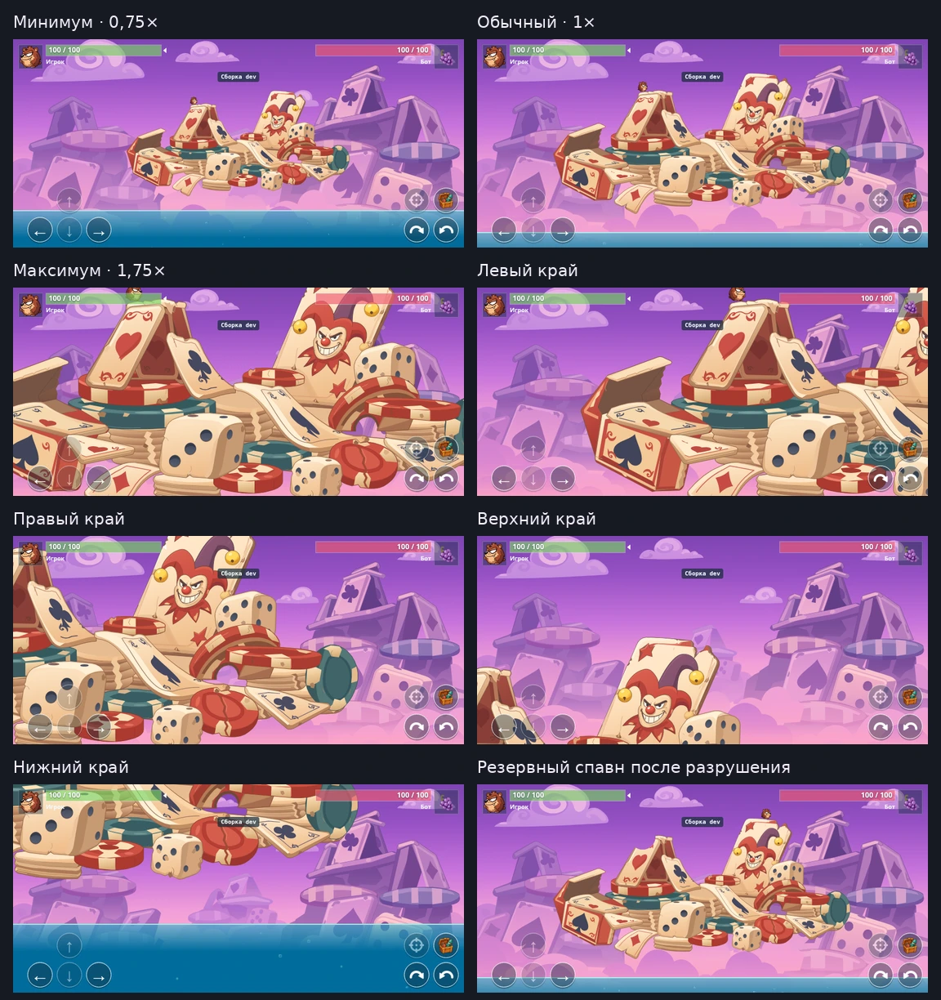

# Проверка карты, камеры и спавна

Код проверенной версии — `f0b2085`. Проверки выполнены в Chromium 156 через Playwright. Скриншоты сняты с работающей игры в мобильном альбомном кадре 844 × 390.

| Кадр | PNG |
| --- | --- |
| Минимум, 0,75× | [Открыть](screenshots/01-minimum.png) |
| Обычный масштаб, 1× | [Открыть](screenshots/02-normal.png) |
| Максимум, 1,75× | [Открыть](screenshots/03-maximum.png) |
| Левый край | [Открыть](screenshots/04-left.png) |
| Правый край | [Открыть](screenshots/05-right.png) |
| Верхний край | [Открыть](screenshots/06-top.png) |
| Нижний край | [Открыть](screenshots/07-bottom.png) |
| Возрождение на крыше с джокером после разрушения исходной опоры | [Открыть](screenshots/08-destroyed-spawn.png) |

## Что проверено

- **20 точек на пяти картах.** Для каждой движок нашёл опору по текущей маске и коллайдерам. Персонаж встал на поверхность после шага физики. На «Карточном домике» проверены [крыша с червами (770, 272)](screenshots/spawn-1.png), [крыша с джокером (1410, 180)](screenshots/spawn-2.png), [левая колода (550, 438)](screenshots/spawn-3.png) и [правая фишка (1650, 562)](screenshots/spawn-4.png).
- **Разрушение и возрождение.** Движок вырезал опору из маски и SVG. После физического падения в воду игрок возродился на второй точке. Когда эту точку занял другой персонаж, следующее падение привело к возрождению на третьей. При уничтожении всех точек игрок остался вне игры с заблокированным выстрелом.
- **Старый конфиг и поражение.** Карта со старой парой X создаёт персонажа на прежней позиции. В дуэли без возрождения падение в воду по-прежнему обнуляет здоровье.
- **Камера.** Проверены 0,75×, 1× и 1,75×. При движении по горизонтали камера ограничена краями мира, когда обзор уже мира. По вертикали есть запас до 20% высоты экрана с пределом 180 экранных пикселей. У грунта и персонажей совпадает `viewBox`, у воды — расчётная экранная координата. Графика ракеты использует текущие координаты её физического тела во время приближения камеры. После выстрела через HUD проверено изменение SVG-кратера и маски столкновений.
- **Фон.** Проверена одинаковая пропорция по осям и полное покрытие области при зуме и панорамировании. Размер окна менялся во время игры между 844 × 390, 1280 × 720, 1024 × 320 и 390 × 844.
- **Собранная версия.** Через `npm run preview` проверены карта по умолчанию, ходьба, приближение двумя касаниями и выстрел. Поворот интерфейса MAX проверен в Chromium с имитацией Android-платформы. Проверка в реальном MAX WebView и замер FPS на телефоне не проводились.
- **Исходный грунт.** Git-объект `terrain.svg` совпадает с версией из `main` на момент проверки, `010c251794031dee8bd9823c75c9dd5f3041beb2`.

## Как повторить

Установите зависимости проекта и Python Playwright. Для скриптов требуется Chromium, путь к нему можно задать через `CHROMIUM`.

1. Запустите `npm run dev` и в другом терминале `python qa/check_game.py`. Скрипт временно открывает доступ к физике только в тестовой вкладке, чтобы задать занятость, разрушение и падение в нужных местах.
2. Выполните `npm run build`, запустите `npm run preview` и выполните `python qa/check_build.py`. В этом тесте игровые модули загружаются из обычной сборки.
3. При другом адресе задайте переменную `GAME_URL`. PNG сохраняются в `qa/screenshots`.

[Протокол игровой проверки](game.log) · [Сборка](build.log) · [Проверка сборки в браузере](preview.log)
